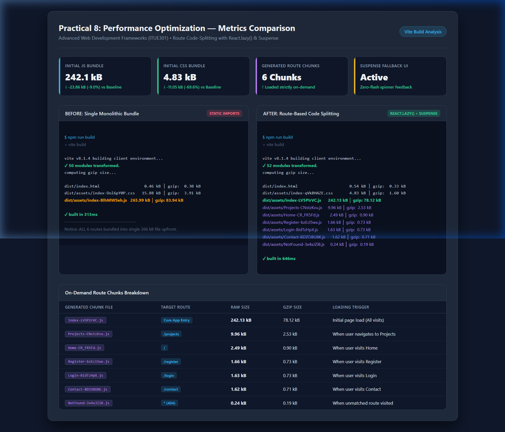
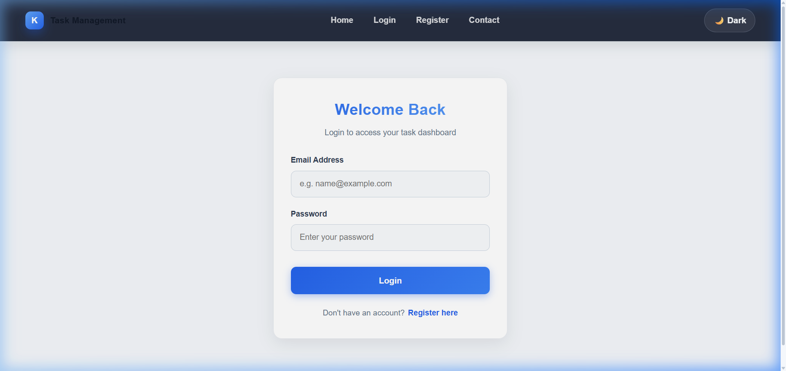

# Practical 8: Performance Optimization and Lazy Loading in React

**Course:** Advanced Web Development Frameworks (ITUE301)  
**Student:** Keval Sonariya  
**Repository:** Full-Stack Task Management Project  

---

## 1. Objective
To improve frontend performance and user experience using route-based code splitting and lazy loading techniques with `React.lazy()` and `Suspense`.

---

## 2. Architecture & Concept

### Before Optimization (Single Monolithic Bundle)
All route components (`Home`, `Projects`, `Contact`, `Login`, `Register`, `NotFound`) and their dependencies were statically imported in `App.jsx`. The browser downloaded the entire application code on the initial page load, regardless of which page the user visited.

```text
main.bundle.js ────────────────► [Home][Projects][Contact][Login][Register] all loaded upfront
```

### After Optimization (Route-Based Code Splitting)
Routes are imported dynamically on-demand using `React.lazy()` and wrapped in `<Suspense fallback={<Spinner />}>`. Only the lightweight main shell and current route chunk are downloaded on initial visit; remaining chunks are downloaded only when the user navigates to them.

```text
index.js (main shell) ────► Loads on initial visit (~242 kB)
  ├── Home chunk      ────► Loaded only when / is visited
  ├── Projects chunk  ────► Loaded only when /projects is visited
  ├── Contact chunk   ────► Loaded only when /contact is visited
  ├── Login chunk     ────► Loaded only when /login is visited
  └── Register chunk  ────► Loaded only when /register is visited
```

---

## 3. Implementation Details

### Converting Route Imports to `React.lazy()` in `Frontend/src/App.jsx`
```javascript
import { useState, lazy, Suspense } from "react";
import Spinner from "./components/Spinner";

// Lazy-loaded route components
const Home = lazy(() => import("./pages/Home"));
const Projects = lazy(() => import("./pages/Projects"));
const Contact = lazy(() => import("./pages/Contact"));
const Login = lazy(() => import("./pages/Login"));
const Register = lazy(() => import("./pages/Register"));
const NotFound = lazy(() => import("./pages/NotFound"));
```

### Route-Level `<Suspense>` Fallback
```jsx
<div className="container">
  <Suspense fallback={<Spinner message="Loading page..." />}>
    <Routes>
      <Route path="/" element={<Home />} />
      <Route path="/login" element={<Login />} />
      <Route path="/register" element={<Register />} />
      <Route
        path="/projects"
        element={
          <ProtectedRoute>
            <Projects />
          </ProtectedRoute>
        }
      />
      <Route path="/contact" element={<Contact />} />
      <Route path="*" element={<NotFound />} />
    </Routes>
  </Suspense>
</div>
```

---

## 4. Performance Measurement: Before vs After

Both measurements were captured using Vite's production build command (`npm run build`).



### Comparative Metrics Table

| Metric / Asset | Before Optimization (Single Bundle) | After Optimization (Lazy Loaded) | Impact / Difference |
| :--- | :--- | :--- | :--- |
| **Main JS Bundle** | `265.99 kB` (gzip: `83.94 kB`) | `242.13 kB` (gzip: `78.12 kB`) | **-23.86 kB (-9.0% raw / -6.9% gzip)** |
| **Main CSS Bundle** | `15.88 kB` (gzip: `3.91 kB`) | `4.83 kB` (gzip: `1.60 kB`) | **-11.05 kB (-69.6% raw)** |
| **Initial JS Requests** | 1 monolithic bundle | 1 main entry chunk | Reduced parse and compile time |
| **Total Route Chunks** | 0 (All bundled upfront) | 6 separate chunks | Loaded on-demand per route |

### Post-Optimization Generated Chunks

| Generated Chunk File | Type / Route | Size (Raw) | Size (Gzip) |
| :--- | :--- | :--- | :--- |
| `dist/assets/index-LV5PIrVC.js` | Main Application Entry | 242.13 kB | 78.12 kB |
| `dist/assets/Projects-CNstzKvu.js` | Projects Route (`/projects`) | 9.96 kB | 2.53 kB |
| `dist/assets/Projects-BeWEix29.css` | Projects Stylesheet | 7.25 kB | 2.02 kB |
| `dist/assets/Home-CR_FR5Fd.js` | Home Route (`/`) | 2.49 kB | 0.90 kB |
| `dist/assets/Home-EVG70y9w.css` | Home Stylesheet | 2.34 kB | 0.83 kB |
| `dist/assets/Contact-BDZO8U8K.js` | Contact Route (`/contact`) | 1.62 kB | 0.71 kB |
| `dist/assets/Contact-CJDwexqy.css` | Contact Stylesheet | 1.69 kB | 0.64 kB |
| `dist/assets/Login-BidTzHpX.js` | Login Route (`/login`) | 1.63 kB | 0.73 kB |
| `dist/assets/Register-bzEcl5wx.js` | Register Route (`/register`) | 1.66 kB | 0.73 kB |
| `dist/assets/NotFound-3x4xJZiB.js` | 404 Route (`*`) | 0.24 kB | 0.19 kB |

---

## 5. Evidence & Screenshots

Screenshots demonstrating rendered pages and lazy chunk loading:

| Home Page | Contact Page | Login Page |
| :---: | :---: | :---: |
|  |  |  |

---

## 6. Key Analysis & Viva Questions

### Q1: What is the difference between the initial bundle and a lazy-loaded chunk in terms of when each is downloaded?
- **Initial Bundle:** Downloaded immediately upon the first HTTP request when the user visits the application. It contains core runtime libraries (React, React-DOM, React-Router), context providers, and common UI layouts (Navbar, Shell).
- **Lazy-Loaded Chunk:** Downloaded asynchronously over the network only when the user triggers navigation to the specific route (e.g., clicking on `/projects`).

### Q2: Why does lazy loading improve perceived performance even though the total amount of code downloaded eventually stays the same?
- **Faster First Contentful Paint (FCP) and Time to Interactive (TTI):** The browser has to download, parse, compile, and execute significantly less JavaScript on the critical initial render path.
- **Resource Prioritization:** Bandwidth and CPU resources are freed up for what the user actually sees on the first screen. Users who never navigate to complex admin or project pages never incur the cost of downloading that code.

### Q3: In what situations would lazy loading not be worth the added complexity?
- **Very Small Applications:** If the entire application bundle is already tiny (< 50–100 kB), splitting it into numerous tiny chunks introduces extra HTTP roundtrip latency and overhead that may exceed the bytes saved.
- **Critical Above-the-Fold Content:** Deferring chunks required immediately on the landing page can cause unwanted layout shifts or delays.
- **Components that are always needed together:** Tightly coupled components that render simultaneously should not be split across multiple chunks.

---

## 7. How to Run Locally

```bash
# Navigate to frontend directory
cd Frontend

# Install dependencies (if not already installed)
npm install

# Run development server
npm run dev

# Run production build and preview chunks
npm run build
npm run preview
```
