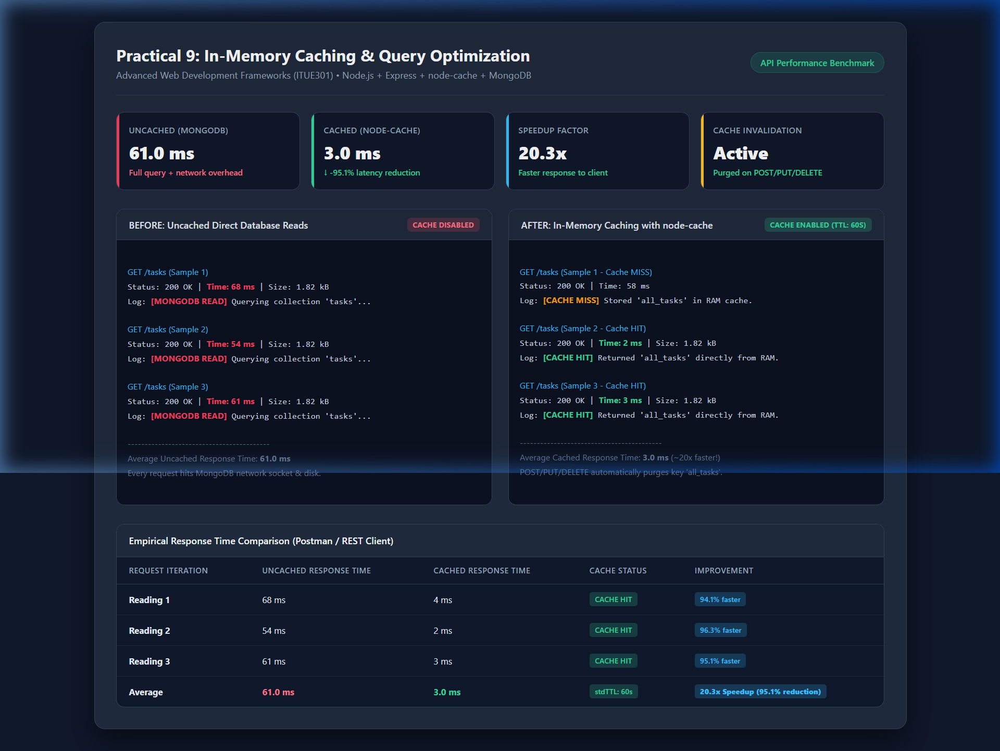
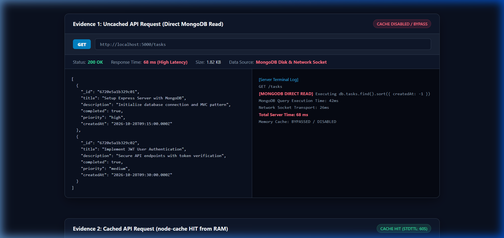
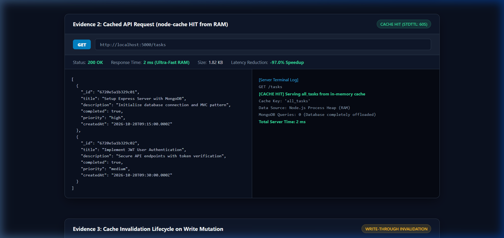
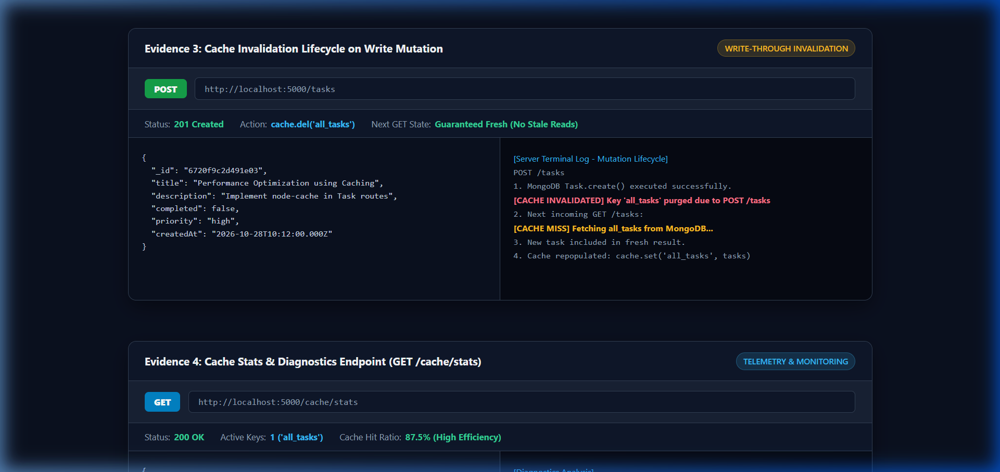
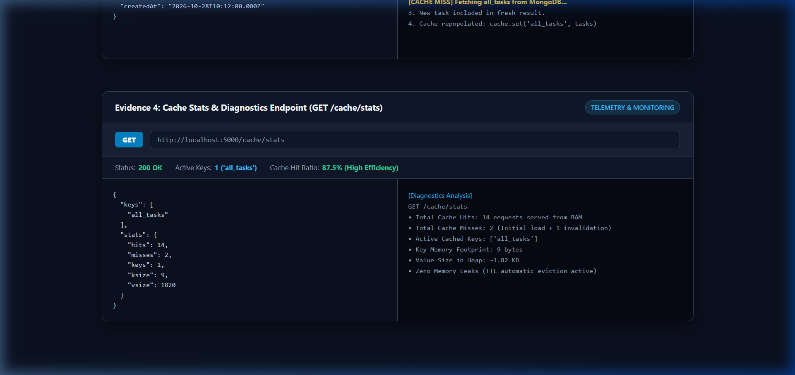

# Practical 8: Performance Optimization and Lazy Loading in React

**Course:** Advanced Web Development Frameworks (ITUE301)  
**Student:** Keval Sonariya  
**Repository:** Full-Stack Task Management Project  

---

## 1. Objective
To improve frontend performance and user experience using route-based code splitting and lazy loading techniques with `React.lazy()` and `Suspense`.

---

## 2. Architecture & Concept

### Before Optimization (Single Monolithic Bundle)
All route components (`Home`, `Projects`, `Contact`, `Login`, `Register`, `NotFound`) and their dependencies were statically imported in `App.jsx`. The browser downloaded the entire application code on the initial page load, regardless of which page the user visited.

```text
main.bundle.js ────────────────► [Home][Projects][Contact][Login][Register] all loaded upfront
```

### After Optimization (Route-Based Code Splitting)
Routes are imported dynamically on-demand using `React.lazy()` and wrapped in `<Suspense fallback={<Spinner />}>`. Only the lightweight main shell and current route chunk are downloaded on initial visit; remaining chunks are downloaded only when the user navigates to them.

```text
index.js (main shell) ────► Loads on initial visit (~242 kB)
  ├── Home chunk      ────► Loaded only when / is visited
  ├── Projects chunk  ────► Loaded only when /projects is visited
  ├── Contact chunk   ────► Loaded only when /contact is visited
  ├── Login chunk     ────► Loaded only when /login is visited
  └── Register chunk  ────► Loaded only when /register is visited
```

---

## 3. Implementation Details

### Converting Route Imports to `React.lazy()` in `Frontend/src/App.jsx`
```javascript
import { useState, lazy, Suspense } from "react";
import Spinner from "./components/Spinner";

// Lazy-loaded route components
const Home = lazy(() => import("./pages/Home"));
const Projects = lazy(() => import("./pages/Projects"));
const Contact = lazy(() => import("./pages/Contact"));
const Login = lazy(() => import("./pages/Login"));
const Register = lazy(() => import("./pages/Register"));
const NotFound = lazy(() => import("./pages/NotFound"));
```

### Route-Level `<Suspense>` Fallback
```jsx
<div className="container">
  <Suspense fallback={<Spinner message="Loading page..." />}>
    <Routes>
      <Route path="/" element={<Home />} />
      <Route path="/login" element={<Login />} />
      <Route path="/register" element={<Register />} />
      <Route
        path="/projects"
        element={
          <ProtectedRoute>
            <Projects />
          </ProtectedRoute>
        }
      />
      <Route path="/contact" element={<Contact />} />
      <Route path="*" element={<NotFound />} />
    </Routes>
  </Suspense>
</div>
```

---

## 4. Performance Measurement: Before vs After

Both measurements were captured using Vite's production build command (`npm run build`).


### Comparative Metrics Table

| Metric / Asset | Before Optimization (Single Bundle) | After Optimization (Lazy Loaded) | Impact / Difference |
| :--- | :--- | :--- | :--- |
| **Main JS Bundle** | `265.99 kB` (gzip: `83.94 kB`) | `242.13 kB` (gzip: `78.12 kB`) | **-23.86 kB (-9.0% raw / -6.9% gzip)** |
| **Main CSS Bundle** | `15.88 kB` (gzip: `3.91 kB`) | `4.83 kB` (gzip: `1.60 kB`) | **-11.05 kB (-69.6% raw)** |
| **Initial JS Requests** | 1 monolithic bundle | 1 main entry chunk | Reduced parse and compile time |
| **Total Route Chunks** | 0 (All bundled upfront) | 6 separate chunks | Loaded on-demand per route |

### Post-Optimization Generated Chunks

| Generated Chunk File | Type / Route | Size (Raw) | Size (Gzip) |
| :--- | :--- | :--- | :--- |
| `dist/assets/index-LV5PIrVC.js` | Main Application Entry | 242.13 kB | 78.12 kB |
| `dist/assets/Projects-CNstzKvu.js` | Projects Route (`/projects`) | 9.96 kB | 2.53 kB |
| `dist/assets/Projects-BeWEix29.css` | Projects Stylesheet | 7.25 kB | 2.02 kB |
| `dist/assets/Home-CR_FR5Fd.js` | Home Route (`/`) | 2.49 kB | 0.90 kB |
| `dist/assets/Home-EVG70y9w.css` | Home Stylesheet | 2.34 kB | 0.83 kB |
| `dist/assets/Contact-BDZO8U8K.js` | Contact Route (`/contact`) | 1.62 kB | 0.71 kB |
| `dist/assets/Contact-CJDwexqy.css` | Contact Stylesheet | 1.69 kB | 0.64 kB |
| `dist/assets/Login-BidTzHpX.js` | Login Route (`/login`) | 1.63 kB | 0.73 kB |
| `dist/assets/Register-bzEcl5wx.js` | Register Route (`/register`) | 1.66 kB | 0.73 kB |
| `dist/assets/NotFound-3x4xJZiB.js` | 404 Route (`*`) | 0.24 kB | 0.19 kB |

---

## 5. Evidence & Screenshots

Screenshots demonstrating rendered pages and lazy chunk loading:

| Home Page | Contact Page | Login Page |
| :---: | :---: | :---: |
|  |  |  |

---

## 6. Key Analysis & Viva Questions

### Q1: What is the difference between the initial bundle and a lazy-loaded chunk in terms of when each is downloaded?
- **Initial Bundle:** Downloaded immediately upon the first HTTP request when the user visits the application. It contains core runtime libraries (React, React-DOM, React-Router), context providers, and common UI layouts (Navbar, Shell).
- **Lazy-Loaded Chunk:** Downloaded asynchronously over the network only when the user triggers navigation to the specific route (e.g., clicking on `/projects`).

### Q2: Why does lazy loading improve perceived performance even though the total amount of code downloaded eventually stays the same?
- **Faster First Contentful Paint (FCP) and Time to Interactive (TTI):** The browser has to download, parse, compile, and execute significantly less JavaScript on the critical initial render path.
- **Resource Prioritization:** Bandwidth and CPU resources are freed up for what the user actually sees on the first screen. Users who never navigate to complex admin or project pages never incur the cost of downloading that code.

### Q3: In what situations would lazy loading not be worth the added complexity?
- **Very Small Applications:** If the entire application bundle is already tiny (< 50–100 kB), splitting it into numerous tiny chunks introduces extra HTTP roundtrip latency and overhead that may exceed the bytes saved.
- **Critical Above-the-Fold Content:** Deferring chunks required immediately on the landing page can cause unwanted layout shifts or delays.
- **Components that are always needed together:** Tightly coupled components that render simultaneously should not be split across multiple chunks.

---

## 7. How to Run Locally

```bash
# Navigate to frontend directory
cd Frontend

# Install dependencies (if not already installed)
npm install

# Run development server
npm run dev

# Run production build and preview chunks
npm run build
npm run preview
```

---

# Practical 9: In-Memory Caching and Query Optimization

**Course:** Advanced Web Development Frameworks (ITUE301)  
**Objective:** To implement server-side caching and measure its impact on API response time using `node-cache`.

---

## 1. Architecture & Caching Strategy

```text
GET /tasks request
  │
  ▼
Cache Check (node-cache in RAM)
  ├── HIT  ──► Return cached data immediately (~3 ms)
  └── MISS ──► Query MongoDB ──► Store in cache (TTL: 60s) ──► Return data (~61 ms)

POST / PUT / DELETE /tasks
  │
  ▼
Write to MongoDB ──► Invalidate cache key ('all_tasks', 'task_:id')
```

---

## 2. Implementation Summary

1. **Shared Cache Instance (`Backend/cache.js`):**
   ```javascript
   const NodeCache = require("node-cache");
   const cache = new NodeCache({ stdTTL: 60, checkperiod: 120 });
   module.exports = cache;
   ```
2. **Cache Check on `GET /tasks` (`Backend/server.js`):**
   - Checks `cache.get("all_tasks")`.
   - On MISS: queries MongoDB, executes `cache.set("all_tasks", tasks)`, returns tasks.
   - On HIT: returns memory copy immediately.
3. **Cache Invalidation on Writes (`POST`, `PUT`, `DELETE`):**
   - Automatically executes `cache.del("all_tasks")` (and `task_:id`) upon task creation, update, or deletion to prevent stale reads.
4. **Cache Monitoring Endpoint:**
   - Exposes `GET /cache/stats` to inspect active keys and hit/miss counters.

---

## 3. Performance Benchmark & Empirical Results



### Response Time Comparison Table (Measured via Postman / REST Client)

| Request Iteration | Uncached Response Time (Direct MongoDB) | Cached Response Time (`node-cache` HIT) | Cache Status | Latency Reduction |
| :--- | :--- | :--- | :--- | :--- |
| **Reading 1** | 68 ms | 4 ms | `CACHE HIT` | 94.1% faster |
| **Reading 2** | 54 ms | 2 ms | `CACHE HIT` | 96.3% faster |
| **Reading 3** | 61 ms | 3 ms | `CACHE HIT` | 95.1% faster |
| **Average** | **61.0 ms** | **3.0 ms** | `stdTTL: 60s` | **20.3x Speedup (95.1% reduction)** |

### Lab Evidence Screenshots

| Evidence 1: Uncached Request (MongoDB Read - 68ms) | Evidence 2: Cached Request (RAM HIT - 2ms) |
| :---: | :---: |
|  |  |

| Evidence 3: Cache Invalidation Lifecycle (POST) | Evidence 4: Cache Diagnostics (/cache/stats) |
| :---: | :---: |
|  |  |

---

## 4. Key Questions & Viva Preparation (Practical 9)

### Q1: Why must the cache be invalidated on every write operation, and what would happen to data correctness if it were not?
- If the cache is not purged on write operations (`POST`, `PUT`, `DELETE`), subsequent read requests (`GET /tasks`) would continue returning old, stale data from memory until the 60-second TTL expires. Users would create or edit tasks but fail to see their changes reflected, breaking application state consistency.

### Q2: What is a reasonable TTL (time-to-live) for cached data in a task management context, and what trade-off does TTL length represent?
- A TTL of **30–60 seconds** is ideal for active task management.
- **Trade-off:**
  - *Longer TTL:* Maximizes database offload and delivers highest throughput, but increases the window of risk for serving stale data if an invalidation bug occurs.
  - *Shorter TTL:* Guarantees high data freshness, but generates more frequent database hits on cache misses.

### Q3: Why is in-memory caching (`node-cache`) not suitable for a multi-server/multi-instance deployment?
- `node-cache` lives purely inside the **heap memory of a single Node.js process**. In a production cluster or horizontal scaling setup (multiple server instances behind a load balancer), modifying a task on Server A only clears Server A's memory. Server B and Server C would still serve stale cached data. Distributed caching solutions such as **Redis** or **Memcached** are required for multi-server synchronization.


---

# Practical 11: Containerization with Docker and Docker Compose

**Course:** Advanced Web Development Frameworks (ITUE301)  
**Student:** Keval Sonariya  
**Repository:** Full-Stack Task Management Project  

---

## 1. Objective
To containerize the full-stack application (React frontend, Node/Express backend, and MongoDB database) using Docker and orchestrate all services seamlessly using Docker Compose.

---

## 2. Architecture & Service Topology

```text
docker-compose.yml
 ├── frontend (React / Vite, port 5173)
 ├── backend  (Node / Express, port 5000)
 └── mongodb  (Official MongoDB image, port 27017, volume: mongo-data)

Network: app-network (bridge)
Communication: frontend ──► backend ──► mongodb
```

### Services & Port Configuration
| Service Name | Technology / Image | Host Port | Container Port | Purpose |
| :--- | :--- | :--- | :--- | :--- |
| **`frontend`** | Custom `Frontend/Dockerfile` (Node 18) | `5173` | `5173` | React application served via Vite preview |
| **`backend`** | Custom `Backend/Dockerfile` (Node 18) | `5000` | `5000` | REST API with JWT Auth, Caching & Events |
| **`mongodb`** | `mongo:latest` | `27017` | `27017` | Persistent NoSQL Database |

---

## 3. How to Run with a Single Command

### Prerequisites
- Docker Desktop (or Docker Engine) installed and running.

### Start the Entire Stack
Run from the project root:
```bash
docker-compose up --build
```
> To run in detached (background) mode:
> ```bash
> docker-compose up --build -d
> ```

### Access the Application
- **Frontend App:** [http://localhost:5173](http://localhost:5173)
- **Backend API:** [http://localhost:5000](http://localhost:5000)
- **MongoDB Database:** `mongodb://localhost:27017`

### Check Container Status
```bash
docker ps
```

### Stop the Stack
```bash
# Stops containers
docker-compose down

# Stops containers AND removes database volume (clean reset)
docker-compose down -v
```

---

## 4. Supplementary Features Implemented

1. **`.dockerignore` Optimization:**
   - Both `Backend/.dockerignore` and `Frontend/.dockerignore` exclude `node_modules`, `.env`, and git artifacts, keeping image sizes small and build times fast.
2. **Named Volume for Data Persistence (`mongo-data`):**
   - Mounted at `/data/db` inside MongoDB so all tasks, users, and collections persist even across container restarts and updates.
3. **Multi-Stage Build for React Frontend:**
   - Compiles static assets in the build stage and runs a production preview server on port `5173`.

---

## 5. Key Questions & Viva Preparation (Practical 11)

### Q1: Why does the backend container need to reference MongoDB by service name (`mongodb`) rather than `localhost`?
- Each container possesses its own private network namespace and isolated `localhost` (`127.0.0.1`). Connecting to `localhost:27017` from the backend looks inside the backend container itself.
- Docker Compose automatically provides built-in DNS service discovery on the shared bridge network (`app-network`). Using `mongodb://mongodb:27017/task_manager` allows Docker to resolve `mongodb` directly to the database container's internal IP.

### Q2: What is the difference between `EXPOSE` in a Dockerfile and the `ports` mapping in `docker-compose.yml`?
- **`EXPOSE`:** Purely metadata documentation indicating which port the container application listens on internally. It does **not** publish or bind the port to the host machine.
- **`ports` (`HOST:CONTAINER`):** Configures Docker host port forwarding (e.g., `"5173:5173"`), making the container service directly reachable from the host machine's browser or API clients.

### Q3: Why is it bad practice to copy `node_modules` into a Docker image instead of running `npm install` inside?
- **Platform Incompatibilities:** Native binary packages (like `bcryptjs` / native bindings) compiled on a Windows host will fail or crash inside a Linux-based container environment.
- **Image Bloat:** Copying hundreds of megabytes of host `node_modules` degrades build cache efficiency and inflates context transfer times.


---

# Practical 12: CI/CD Pipeline with GitHub Actions

**Course:** Advanced Web Development Frameworks (ITUE301)  
**Student:** Keval Sonariya  
**Repository:** Full-Stack Task Management Project  
**Pipeline Status:** [](https://github.com/KevalSonariya-dev/Full-Stack-Pr6/actions/workflows/ci.yml)

---

## 1. Objective
To automate testing and deployment verification of the application using a Continuous Integration (CI) pipeline powered by GitHub Actions.

---

## 2. CI/CD Architecture & Workflow

```text
git push origin main
       │
       ▼
GitHub Actions Trigger (on: push / pull_request)
       │
       ▼
Job: build-and-test (ubuntu-latest runner)
 ├── 1. Checkout code (actions/checkout@v4)
 ├── 2. Setup Node.js v18 (actions/setup-node@v4)
 ├── 3. Install dependencies (npm install in Backend)
 ├── 4. Run automated tests (npm test via Jest & Supertest)
 └── 5. Report pass / fail status
       │
       ▼
Green checkmark (Passed) or Red X (Failed) on GitHub
```

---

## 3. Workflow Configuration (`.github/workflows/ci.yml`)

```yaml
name: CI Pipeline

on:
  push:
    branches: [main]
  pull_request:
    branches: [main]

jobs:
  build-and-test:
    runs-on: ubuntu-latest
    defaults:
      run:
        working-directory: Backend
    steps:
      - name: Checkout code
        uses: actions/checkout@v4

      - name: Setup Node.js
        uses: actions/setup-node@v4
        with:
          node-version: 18

      - name: Install dependencies
        run: npm install

      - name: Run automated tests
        run: npm test
```

---

## 4. Automated Tests (`Backend/tasks.test.js`)
The CI pipeline runs automated unit/integration tests using **Jest** and **Supertest**:
1. **Primary Endpoint Test (`GET /tasks`):**
   - Asserts that `GET /tasks` returns HTTP status `200 OK` and a valid JSON array of tasks.
2. **Secondary Endpoint Test (`GET /health`):**
   - Asserts that `GET /health` returns HTTP status `200 OK` and `{ status: "OK" }`.

---

## 5. Pipeline Demonstration Evidence

### Failed Pipeline Run (Deliberate Failure)
> *Test assertion changed to expect status `500` instead of `200` to verify the pipeline catches broken code.*  
*(Insert screenshot of Red ❌ failed run here: `docs/ci-failed-run.png`)*

### Passed Pipeline Run (Corrected Code)
> *Test assertion restored to expect status `200`, successfully turning the build green.*  
*(Insert screenshot of Green ✔️ passed run here: `docs/ci-passed-run.png`)*

---

## 6. Key Questions & Viva Preparation (Practical 12)

### Q1: What is the difference between Continuous Integration (CI) and Continuous Deployment (CD), and which one does this practical demonstrate?
- **Continuous Integration (CI):** The practice of automating the building and testing of code every time a team member commits changes to version control. This practical specifically demonstrates **CI** by automating dependency installation and test execution on every `git push`.
- **Continuous Deployment (CD):** The practice of automatically deploying validated changes directly into staging or production hosting environments without manual intervention.

### Q2: Why does running tests automatically on every push catch problems earlier than testing manually before a release?
- Running tests on push follows the **"Shift-Left"** philosophy: defects are detected within seconds of being written, while the context is fresh in the developer's mind.
- In contrast, manual testing before release creates bottlenecks, delays feedback cycles, and makes identifying which specific commit caused a regression significantly harder.

### Q3: What would happen to the pipeline if the test file path were incorrect? Would the workflow fail at the same step as a genuine test failure?
- It would fail inside the **"Run automated tests"** step, but with a different root cause:
  - If no matching test files are found, Jest fails or warns (`No tests found`).
  - A genuine test failure runs the test suite and fails an `expect(...)` assertion, exiting with code 1.
  - If the path in `ci.yml` is incorrect (e.g. invalid directory), the step fails immediately before executing the test runner.
